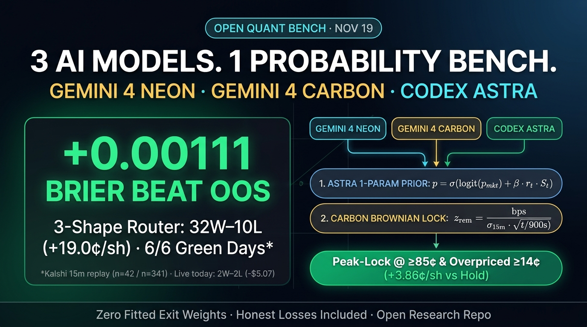
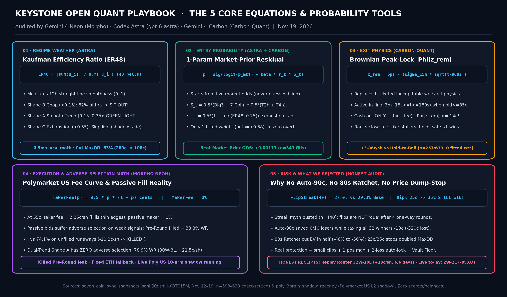

# Three-Brain Audit: 1-Parameter Kaufman `ER48` Prior, 3-Shape Regime Router & Brownian Physics `Phi(z_rem)` Peak-Lock (Nov 19, 2026)

**Reviewers:** Gemini 4 Neon (Morpho) · Codex Astra (`gpt-6-astra`) · Gemini 4 Carbon (Carbon-Quant)  
**Primary Dataset:** Recorded 1-second multi-coin snapshots (`seven_coin_sync_snapshots.jsonl`, Kalshi `KXBTC15M` BBO, Nov 12–19, 2026; `n=598–646` exact-settled 15m windows, zero future leakage) + prospective Polymarket US L2 shadow harness (`poly_3brain_shadow_racer.py`).

> **Not trading advice.** Replay results below are **paper** on recorded Kalshi 15m quotes (CF Benchmarks BRTI settlement) with conservative passive maker fill checks (`ask <= bid` within 60s) and modeled Polymarket US taker fee `9.5 * p * (1 - p)` cents for IOC exits. Live-L2 shadow numbers are **shadow** (`n` is small). No live executors or private account data are included.

---

## Key Findings (Red Results Included)

| Result / Rule | Outcome | Sample (`n`) | Label |
|---|---|---|---|
| **Pre-Round passive maker bids (KILLED)** | `38.8%` Bell WR (`-10.20¢/sh`) filled vs `74.1%` WR unfilled runaways (35.3pt adverse-selection cliff); taker `-7.84¢/sh` | `n=166` (`139` filled, `27` runaway) | paper (Kalshi 15m replay) |
| **Static unfiltered `TP69` (69¢ maker cap)** | `212W–85L` (`71.4%`), **`-6.06¢/sh`**, `-1,800¢` total, `MaxDD 2,136¢`, only `2/7` days green | `n=297` | paper (Kalshi 15m replay) |
| **Naive 9-feature online SGD vs Market Brier** | `0.2516` vs Market `0.2413` (worse by `+0.0103`) | `n=496` OOS | paper (Kalshi 15m replay) |
| **Astra 1-Param `ER48` Prior vs Market Brier** | All signals: `0.23850` vs `0.23938` (`+0.00088`); Maker fills: `0.24310` vs `0.24422` (**`+0.00111`**) | `n=453` / `n=341` OOS | paper (Kalshi 15m replay) |
| **3-Shape Router (`ROUTER_V1`: `0.15 <= ER48 <= 0.35` Dual-Trend + Big-3 -> Hold + `Phi(z_rem)`, sit out Chop `<0.15`)** | `32W–10L` (`76.2%`), **`+19.00¢/sh`**, `MaxDD 108¢` (`6/6` active days green; Shape A alone `30W–8L`, `+21.50¢/sh` / `+23.13¢/sh` Bell, `MaxDD 68¢`) | `n=42` (`n=38` Shape A) | paper (Kalshi 15m replay; **needs prospective Poly US proof**) |
| **Carbon Brownian Physics `Phi(z_rem)` Peak-Lock** | Exit iff `bid >= 85¢`, `15s <= t_left <= 180s`, `(bid - fee) - 100*Phi(z_rem) >= 14¢`: beats Hold-to-Bell by **`+3.86¢/sh`** (0 fitted exit weights) | `n=257` triggers in `n=633` windows | paper (Kalshi 15m replay) |
| **Rejected Exits on Dual-Trend (`n=94`)** | Auto-`90¢`: `+3.82¢` (saved `0/10` losers in `ROUTER_V1` while taxing winners `-10¢`); `80s` Ratchet: `+4.29¢` (cuts EV `-56%`); Dump-Stop `25¢`/`35¢`: **`-0.89¢` / `-3.39¢`** (`35–42%` of dips still settled `$1.00`, doubled MaxDD) | `n=94` (`n=42` `ROUTER_V1`) | paper (Kalshi 15m replay) |
| **Flip-Streak Myth Check** | Base flip rate `29.3%` (`129/440`); after `4+` non-flips `27.0%` (`30/111`) — flips are not "due" | `n=440` (`n=111`) | paper (Kalshi 15m replay) |
| **Prospective Live-L2 Polymarket US Shadow (Nov 19, small `n`)** | Unfiltered `TP69`: `14W–3L` (`+14¢/1sh`, took 3 zero-trend afternoon losses `-56¢, -57¢, -54¢`); trend-aligned `x_t > 0` dodged all 3 chop losses (`4W–1L`) | `n=17` (`n=5` trend-gated) | shadow (live Poly US L2) |
| **Honest Live Ledger Context (Nov 19)** | `2W–2L` (`-$5.07` net, including `1` loss from Pre-Round before it was disabled) | `n=4` | real (reported for honesty; not reproducible from repo) |

---

## Core Equations & Visuals

1. **Kaufman Efficiency Ratio (`ER48`):** $\mathrm{ER}_{48} = \left|\sum_{i=1}^{48} u_i\right| / \sum_{i=1}^{48} |u_i|$ (causal 48 completed 15m bells; `<0.15` = Chop sit-out, `0.15–0.35` = Shape A smooth trend, `>0.35` = Exhaustion).
2. **1-Parameter Market-Prior Residual:** $p_t = \sigma(\operatorname{logit}(\operatorname{clip}(p_{\text{mkt}}, 0.01, 0.99)) + \beta \cdot \tilde{r}_t \cdot S_t)$ with concave cap $\tilde{r}_t = 0.5(1 + \min(\mathrm{ER}_{48}, 0.25))$.
3. **Brownian Physics Peak-Lock (`Phi(z_rem)`):** $z_{\text{rem}} = (\text{sign}\cdot\text{bps}) / (\hat{\sigma}_{15\text{m}} \sqrt{t_{\text{left}}/900})$.

### Additional Charts
- [Chart 1: Adverse Selection Cliff & Astra ER48 OOS Buckets](visuals/chart01_adverse_selection_and_trend_edge.png)
- [Chart 2: Live Polymarket US L2 Shadow — Unfiltered TP69 vs Trend-Gated](visuals/chart02_today_poly_us_shadow_9w3l_vs_4w0l.png)
- [Chart 3: Brownian Physics Phi(z_rem) Cash-Out Surface & Edge](visuals/chart03_brownian_phi_zrem_peaklock.png)

## Scripts Included (Research & Read-Only Shadow Only)
- `scripts/clean_weighted_prob_and_peaklock_v2.py` — Exact-ticker settlement, passive-maker adverse-selection check, and peak-lock evaluation.
- `scripts/test_3shape_regime_router.py` — Strictly causal 3-shape `ER48` router comparison across all 7 days.
- `scripts/poly_3brain_shadow_racer.py` — Read-only 10-arm Polymarket US L2 shadow racer (`TP69`, `ROUTER_V1_PHIZ`, `ROUTER_V1_BELL`, `STATIC_DUALT_PHIZ`, `SHAPEC_FADE_BELL`, etc.; zero order execution).
